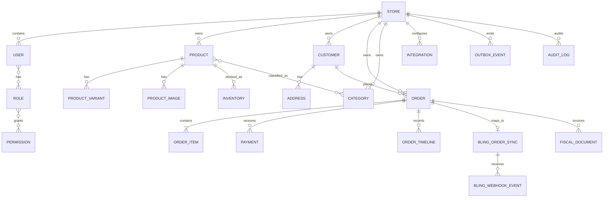

# ERD — núcleo transacional e fiscal

## Dados de integração fiscal

O modelo executável deverá manter uma projeção fiscal independente, relacionada ao pedido e à loja, sem substituir o vínculo já existente de venda Bling:

- Identificação: ID do documento no Bling, ID e número da venda Bling, pedido STOREOS e tipo/modelo de documento.
- Ciclo: estado interno e situação externa/SEFAZ, série e número, chave de acesso, criado/enviado/autorizado/cancelado em, motivo/código de rejeição.
- Arquivos: referências seguras aos artefatos XML e DANFE (armazenamento privado, autorização por permissão e URL curta/temporária; não guardar URL pública irrestrita).
- Confiabilidade: idempotency key, contador e próxima tentativa, último erro sanitizado, webhooks/event IDs processados, trilha e status de conciliação.
- Isolamento/duplicidade: todas as leituras incluem storeId; unicidade por loja+pedido+documento remoto; somente um documento ativo do tipo configurado pode ser emitido por pedido, salvo procedimento de substituição autorizado.

NF-e não é o mesmo que fulfillment: o status “faturado” só é estabelecido quando a autorização for confirmada. Rastreio e expedição continuam independentes.

O schema Prisma é fonte executável do ERD. Valores financeiros usam Decimal(14,2), nunca float; PII identificável exige proteção específica.