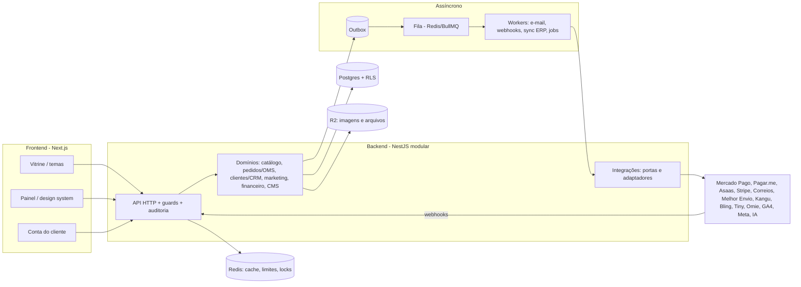
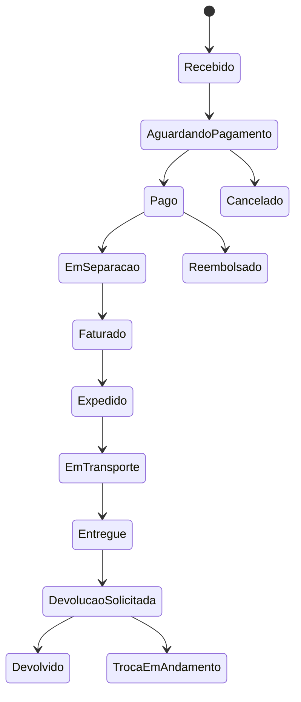

# StoreOS: GAP vs Nuvemshop, roadmap, arquitetura alvo e backlog enterprise

Complementa o [diagnóstico de outubro/2026](diagnostico-e-roadmap-2026-10.md), que continua valendo para achados técnicos, riscos e a ordem das fases. Este documento responde a outra pergunta: **o que falta para ser comparável a Nuvemshop, Shopify e Tray**, e em que ordem entregar.

Legenda de status: ✅ pronto · 🟡 parcial · ❌ não existe. Tamanhos: P, M, G, GG (relativos). Nenhuma data é prometida.

## 1. Estado atual em uma frase

Há uma loja funcional de uma única empresa (vitrine, carrinho, PIX, frete por CEP, editor visual com publicação versionada, painel com tema escuro, auditoria imutável). Falta o que transforma isso em plataforma: catálogo profundo (variações, coleções, kits), OMS completo, CRM, marketing, comunicação por e-mail, multiempresa real e integrações.

## 2. GAP Analysis (StoreOS × Nuvemshop)

### Dashboard

| Recurso | Nuvemshop | StoreOS | Fecha em |
|---|---|---|---|
| Faturamento, pedidos, ticket médio, taxa de pagamento | ✅ | ✅ (30 dias) | n/a |
| Conversão (sessões → pedidos) | ✅ | ❌ (sem coleta de sessões) | Épico 9 |
| Séries por dia, comparação de períodos | ✅ | ❌ | Épico 9 |
| Mais vendidos, produtos parados | ✅ | ❌ | Épico 9 |
| Alertas operacionais (a separar, estoque baixo) | 🟡 | 🟡 (só estoque baixo) | Épico 6 |

### Produtos

| Recurso | Nuvemshop | StoreOS | Fecha em |
|---|---|---|---|
| Cadastro com imagens, preço, estoque | ✅ | ✅ (1 imagem, sem upload múltiplo) | Épico 2 |
| Variações (cor, tamanho) e SKU por variação | ✅ | 🟡 (tabela existe, sem tela nem checkout) | Épico 2 |
| Categorias hierárquicas | ✅ | 🟡 (planas) | Épico 2 |
| Marcas e coleções | ✅ | ❌ | Épico 2 |
| Kits/combos | ✅ | ❌ | Épico 2 |
| SEO por produto (título, descrição, slug) | ✅ | ❌ | Épico 2 |
| Produto digital | ✅ | ❌ | Épico 2 (médio prazo) |
| Peso, dimensões, EAN, custo | ✅ | ❌ | Épico 2 |
| Importação/exportação CSV | ✅ | ❌ | Épico 2 |

### Estoque

| Recurso | Nuvemshop | StoreOS | Fecha em |
|---|---|---|---|
| Saldo por produto | ✅ | ✅ | n/a |
| Reserva atômica no checkout | 🟡 | ✅ (diferencial) | n/a |
| Movimentações com motivo e histórico | ✅ | ❌ | Épico 3 |
| Inventário/contagem, ponto de reposição, múltiplos depósitos | 🟡 | ❌ | Épico 3 |

### Pedidos

| Recurso | Nuvemshop | StoreOS | Fecha em |
|---|---|---|---|
| Lista, filtros, detalhe, linha do tempo | ✅ | ✅ (filtros básicos) | Épico 4 |
| Confirmar pagamento, cancelar | ✅ | ✅ | n/a |
| Separação, faturamento, expedição, rastreio, entrega | ✅ | ❌ | Épico 4 |
| Devolução, troca, reembolso | ✅ | ❌ | Épico 4 |
| Notas internas, etiquetas, exportação | ✅ | ❌ | Épico 4 |

### Clientes

| Recurso | Nuvemshop | StoreOS | Fecha em |
|---|---|---|---|
| Cadastro automático pelo checkout | ✅ | ✅ | n/a |
| Lista, detalhe, histórico, endereços | ✅ | ❌ | Épico 5 |
| Segmentação, LTV, frequência, visão 360° | 🟡 | ❌ | Épico 5 |
| Conta do cliente na vitrine | ✅ | ❌ | Épico 5 |

### Marketing

| Recurso | Nuvemshop | StoreOS | Fecha em |
|---|---|---|---|
| Cupons e descontos | ✅ | ❌ | Épico 7 |
| Promoções automáticas, frete grátis condicional | ✅ | 🟡 (frete grátis acima de valor) | Épico 7 |
| Carrinho abandonado, e-mail marketing | ✅ | ❌ | Épicos 7 e 8 |
| Pixels e analytics (GA4, GTM, Meta) | ✅ | ❌ | Épico 12 |

### Loja (vitrine e CMS)

| Recurso | Nuvemshop | StoreOS | Fecha em |
|---|---|---|---|
| Editor visual (banner, textos, cor) | ✅ | 🟡 (hero, anúncio e cor) | Épico 10 |
| Temas instaláveis e troca de tema | ✅ | ❌ | Épico 10 |
| Páginas institucionais e landing pages | ✅ | ❌ | Épico 10 |
| Vitrines, carrosséis, banners múltiplos | ✅ | ❌ | Épico 10 |
| SEO (sitemap, robots, meta, dados estruturados) | ✅ | 🟡 (sitemap e robots; sem JSON-LD nem meta por página) | Épico 10 |
| Busca com sugestões | ✅ | ✅ | n/a |
| Filtros e ordenação em listagem | ✅ | ❌ | Épico 10 |
| Avaliações, lista de desejos, relacionados | 🟡 | ❌ | Épico 10 |

### Checkout e financeiro

| Recurso | Nuvemshop | StoreOS | Fecha em |
|---|---|---|---|
| PIX automático | ✅ | ✅ (Mercado Pago; precisa de token) | n/a |
| Cartão com parcelamento e boleto | ✅ | ❌ | Épico 11 |
| Checkout de uma página, cupom, CPF/CNPJ | ✅ | 🟡 (uma página; sem cupom nem CPF) | Épico 11 |
| Conciliação, estorno, split | ✅ | ❌ | Épico 11 |
| Idempotência de checkout | 🟡 | ❌ | Épico 11 |

### Marketplaces e redes sociais

| Canal | Nuvemshop | StoreOS | Fecha em |
|---|---|---|---|
| Mercado Livre, Shopee, Amazon, Shein | ✅ (via apps) | ❌ | Épico 12 (longo prazo) |
| Instagram/Facebook Shop, TikTok Shop (catálogo) | ✅ | ❌ | Épico 12 |

### Plataforma

| Recurso | Nuvemshop | StoreOS | Fecha em |
|---|---|---|---|
| Multiloja e multiusuário com papéis | ✅ | ❌ (1 loja por implantação; papel global) | Épico 1 |
| Auditoria, MFA, sessões | 🟡 | 🟡 (auditoria ✅; MFA e sessões ❌) | Épico 1 |
| Domínio próprio, planos e cobrança | ✅ | ❌ | Épico 1 |
| Fidelidade (cashback, pontos, níveis) | 🟡 (apps) | ❌ | Épico 8 |

## 3. Roadmap

Os épicos estão na seção 5. A ordem prioriza o que destrava operação real antes do que amplia alcance.

**Curto prazo (próximas entregas)**
1. Governança: auditoria ✅, depois MFA, sessões e papéis por usuário (Épico 1).
2. OMS: expedição, rastreio, devolução e notas (Épico 4).
3. Comunicação: worker do outbox e e-mails transacionais (Épico 8; depende de conta Resend/SES).
4. Catálogo profundo: variações, marcas, coleções, SEO e upload (Épico 2).

**Médio prazo**
5. Multiempresa tenant-safe: `Membership`, `Company` (CNPJ), RLS, domínio próprio (Épico 1).
6. CRM 360° e conta do cliente (Épico 5); cupons e promoções (Épico 7).
7. Checkout completo: cartão, boleto, parcelamento, conciliação (Épico 11).
8. CMS e temas: páginas, banners, vitrines, preview (Épico 10).
9. Analytics: séries, funil, produtos (Épico 9).

**Longo prazo**
10. Integrações: Bling/Tiny/Omie, Melhor Envio/Correios/Kangu, Pagar.me/Asaas/Stripe (Épico 12).
11. Fidelidade: cashback, pontos, níveis (Épico 8).
12. Marketplaces e redes sociais, IA (OpenAI/Claude) para descrições, atendimento e recomendação.
13. Escala: Redis, filas, worker separado, busca dedicada, cache por loja, particionamento (Épico 13).

## 4. Arquitetura alvo

### 4.1 Visão geral

### 4.2 Multiempresa tenant-safe

- Hierarquia: `Organization` (conta) → `Company` (CNPJ, dados fiscais) → `Store` (vitrine) → dados da loja. Hoje existe só `Store`; `Company` e `Organization` entram de forma aditiva.
- Usuário deixa de pertencer a uma loja: `Membership(user, store, role)`; login só por e-mail com escolha de loja.
- `Role` passa a ter `storeId` (papéis padrão copiados por loja); permissões continuam no catálogo global.
- Isolamento em camadas: (1) toda query filtra `storeId` (já é a regra); (2) Row-Level Security no Postgres com `SET LOCAL app.store_id` por transação; (3) testes automáticos que tentam ler dados de outra loja em cada endpoint.
- Domínio próprio: tabela `StoreDomain` e resolução por `Host`.

### 4.3 OMS

Cada transição: condicional ao estado atual (idempotente), grava linha do tempo com autor, evento no outbox e, quando cabe, e-mail. `Fulfillment` (separação, volumes, rastreio) e `Return` (motivo, itens, reembolso ou troca) são entidades próprias ligadas ao pedido.

### 4.4 Dados novos principais

`Company`, `Membership`, `StoreDomain`, `Brand`, `Collection`, `ProductBundle`, `StockMovement`, `Fulfillment`, `Return`, `Coupon`, `Promotion`, `CustomerProfile` (LTV, frequência, segmentos), `Segment`, `Campaign`, `LoyaltyAccount`/`LoyaltyEntry`, `Page`, `Theme`/`ThemeInstall`, `IntegrationConnection` (credenciais criptografadas), `Session` (controle de sessões), `MfaCredential`. Todas com `storeId` (ou `companyId`) e índices por `(storeId, …)`.

### 4.5 Integrações

Portas por categoria (`PaymentProvider` já existe; entram `ShippingProvider`, `ErpProvider`, `MailProvider`, `AiProvider`, `AnalyticsSink`). Cada conexão é um registro `IntegrationConnection` por loja com credenciais criptografadas (AES-256-GCM, chave em variável de ambiente), status, logs de chamada, reprocessamento e webhooks de entrada assinados.

### 4.6 Performance e escala

Metas de dimensionamento: 100 mil produtos, 1 milhão de clientes, 50 mil pedidos por mês, multiloja.

- Banco: índices compostos por loja, `pg_trgm` + `unaccent` para busca, paginação por cursor nas listagens grandes, particionamento mensal de `AuditLog` e `OutboxEvent`, réplica de leitura quando necessário.
- Cache: Redis para vitrine por loja, limites de requisição (hoje em memória), locks de jobs e sessões; revalidação sob demanda do Next.
- Filas: BullMQ sobre Redis; worker em processo próprio; tentativas com recuo, DLQ e reprocessamento.
- Busca: Postgres até ~100 mil produtos; Meilisearch quando a latência pedir.
- Imagens: R2 com variantes e CDN.

## 5. Backlog (Epic → Feature → User Story → Critérios de aceite)

### Épico 1: Governança, segurança e multiempresa

- **F1.1 Auditoria** ✅ entregue.
  - US: como dono, quero ver quem alterou o quê, para investigar problemas. CA: toda alteração autenticada gera registro; segredos ocultos; negadas aparecem; registros não podem ser editados nem apagados (testado no banco).
- **F1.2 MFA (TOTP)**
  - US: como usuário, quero ativar autenticação em dois fatores. CA: QR e código de confirmação; login exige o código; 10 códigos de recuperação de uso único; desativar exige senha; tentativas limitadas e auditadas.
- **F1.3 Controle de sessões**
  - US: como usuário, quero ver e encerrar sessões abertas. CA: lista com dispositivo, IP e última atividade; encerrar uma ou todas; troca de senha encerra as outras.
- **F1.4 Usuários e papéis por loja**
  - US: como dono, quero convidar usuários e dar papéis. CA: convite por e-mail com expiração; papéis Dono, Administrador, Operador, Catálogo, Financeiro, Atendimento, Leitura; permissões editáveis; ninguém remove o último dono.
- **F1.5 Multiempresa (Company, Membership, RLS)**
  - US: como grupo empresarial, quero várias lojas e CNPJs na mesma conta. CA: usuário com várias lojas escolhe a ativa; dados de uma loja são invisíveis para a outra (teste de isolamento em todos os endpoints); RLS ativo; migração não altera logins existentes.
- **F1.6 LGPD**
  - US: como titular, quero exportar ou excluir meus dados. CA: exportação em JSON; exclusão anonimiza pedidos preservando obrigações fiscais; registro de consentimento.
- **F1.7 Criptografia de segredos e rotação de chaves**: CA: credenciais de integração criptografadas em repouso; rotação sem indisponibilidade.

### Épico 2: Catálogo (PIM)

- **F2.1 Variações**: US: como lojista, quero vender camiseta em cores e tamanhos. CA: opções e valores; SKU, preço e estoque por variação; vitrine mostra seletor; carrinho e pedido guardam a variação.
- **F2.2 Marcas, coleções, categorias hierárquicas**: CA: CRUD; filtros por marca e coleção na vitrine; ordem manual.
- **F2.3 Kits e combos**: CA: kit baixa o estoque dos componentes; preço próprio ou soma com desconto.
- **F2.4 SEO por produto e por categoria**: CA: título, descrição e slug editáveis; redirecionamento ao mudar slug; JSON-LD de produto.
- **F2.5 Upload de imagens e vídeo**: CA: várias imagens com ordem; variantes e CDN; vídeo por URL.
- **F2.6 Dados logísticos e fiscais**: peso, dimensões, EAN, NCM, custo. CA: obrigatórios para ativar frete por peso e emitir NF-e.
- **F2.7 Importação e exportação CSV**: CA: validação linha a linha com relatório de erros; reprocesso seguro.
- **F2.8 Produto digital**: CA: entrega por link seguro com expiração após pagamento.

### Épico 3: Estoque

- **F3.1 Movimentações**: CA: toda alteração de saldo gera movimento com motivo, autor e documento; saldo = soma dos movimentos.
- **F3.2 Inventário e reposição**: CA: contagem com ajuste; alerta abaixo do ponto de reposição.
- **F3.3 Múltiplos depósitos** (médio prazo): CA: saldo por depósito; reserva escolhe o depósito por regra.

### Épico 4: OMS (pedidos)

- **F4.1 Separação**: US: como operador, quero uma fila de pedidos a separar. CA: pedido pago entra na fila; marcar separado com volumes; etiqueta de separação.
- **F4.2 Faturamento**: CA: número e chave da NF-e (manual ou via ERP); anexa XML/PDF.
- **F4.3 Expedição e transporte**: CA: transportadora e código de rastreio; marcar enviado; cliente recebe e-mail; rastreio público por número do pedido.
- **F4.4 Entrega**: CA: confirmação manual ou por rastreio; libera avaliação.
- **F4.5 Cancelamento e reembolso**: CA: cancelar libera estoque; reembolso total/parcial registra estorno no gateway.
- **F4.6 Devolução e troca**: CA: cliente ou operador abre solicitação com motivo e itens; aprovação; reentrada em estoque opcional; troca cria novo pedido vinculado.
- **F4.7 Notas internas, etiquetas, filtros avançados e exportação CSV**.

### Épico 5: Clientes e CRM

- **F5.1 Lista e perfil 360°**: CA: pedidos, valor total, ticket, frequência, última compra, endereços, notas, linha do tempo.
- **F5.2 Segmentação**: CA: regras salvas (ex.: comprou 2+ vezes e não compra há 60 dias); contagem ao vivo; exportação.
- **F5.3 Conta do cliente** (link mágico): CA: histórico, rastreio, endereços; sem senha.
- **F5.4 LTV e RFM**: CA: calculados em job noturno; visíveis no perfil.

### Épico 6: Operação do lojista

- **F6.1 Painel "Hoje"**: pedidos a separar, pagamentos pendentes, estoque baixo, devoluções abertas, cada um com o próximo passo.
- **F6.2 Busca global (⌘K)** e notificações.

### Épico 7: Marketing

- **F7.1 Cupons**: CA: percentual, valor fixo, frete grátis; mínimo, validade, limite por cliente e total; aplicação validada no servidor; relatório de uso.
- **F7.2 Promoções automáticas**: CA: regras por produto, coleção, quantidade ("leve 3 pague 2"); sem acumular com cupom salvo configuração.
- **F7.3 Carrinho abandonado**: CA: carrinho no servidor; sequência de e-mails; recuperação rastreada.
- **F7.4 Campanhas e automações**: CA: gatilhos (boas-vindas, pós-compra, reativação); segmentos como público; métricas de envio e conversão.

### Épico 8: Comunicação e fidelização

- **F8.1 Worker do outbox + MailProvider**: CA: eventos publicados com tentativas e DLQ; e-mails de pedido recebido, pagamento aprovado/recusado, enviado, entregue, carrinho, boas-vindas; histórico de envios por loja.
- **F8.2 Cashback e pontos**: CA: regra por loja; crédito na entrega; expiração; uso no checkout; extrato.
- **F8.3 Indicação**: CA: código por cliente; recompensa quando o indicado compra.
- **F8.4 Níveis (Bronze, Prata, Ouro, Diamante)**: CA: faixas por gasto em 12 meses; benefícios por nível (frete, cashback maior); recálculo automático.

### Épico 9: Analytics

- **F9.1 Comercial**: vendas por dia, comparação de períodos, ticket, conversão (sessões coletadas), funil (visita, carrinho, checkout, pago).
- **F9.2 Marketing**: origem do tráfego (UTM), CAC, ROI por campanha e cupom.
- **F9.3 Produtos**: mais vendidos, parados, abandonados no carrinho, margem.
- **F9.4 Financeiro**: receita por forma de pagamento, taxas, repasses, DRE simplificada (receita, custo, taxas, frete, margem).

### Épico 10: CMS, temas e vitrine

- **F10.1 Páginas e landing pages**: CA: blocos (texto, imagem, vitrine, vídeo, FAQ, botão) sem código; rascunho, publicação, versões; SEO por página.
- **F10.2 Banners e campanhas**: CA: múltiplos banners com agendamento e destino.
- **F10.3 Theme Engine**: CA: tema = pacote de layouts e tokens validado por esquema; instalar, trocar e remover sem perder conteúdo; personalização de cor, fonte e seções; preview em tempo real antes de publicar.
- **F10.4 Home e coleções**: vitrines configuráveis, carrosséis, destaques.
- **F10.5 Categoria**: filtros (preço, marca, atributos, disponibilidade), ordenação, paginação.
- **F10.6 Produto premium**: galeria com zoom, vídeo, avaliações com moderação, relacionados, frete na página, JSON-LD.
- **F10.7 Dark mode da vitrine e acessibilidade AA**.

### Épico 11: Checkout e financeiro

- **F11.1 Checkout de uma página otimizado**: CA: resumo fixo; CPF/CNPJ e telefone; endereço salvo; cupom; sem campos desnecessários.
- **F11.2 Cartão, boleto e parcelamento**: CA: tokenização no navegador (sem dados de cartão no servidor); parcelas com juros configuráveis; 3DS quando exigido.
- **F11.3 Conciliação e estorno**: CA: job relê pagamentos pendentes; divergências aparecem no painel; estorno total/parcial.
- **F11.4 Split de pagamento** (médio prazo): CA: divisão entre lojista e parceiros via gateway que suporte.
- **F11.5 Idempotência**: CA: mesma chave não duplica pedido.

### Épico 12: Integrações e canais

- **F12.1 Framework**: CA: `IntegrationConnection`, credenciais criptografadas, tela de integrações com status e logs, webhooks de saída assinados, reprocessamento.
- **F12.2 ERP**: Bling (produtos, estoque, pedidos, NF-e), depois Tiny e Omie.
- **F12.3 Pagamentos**: Mercado Pago (parcial), Pagar.me, Asaas, Stripe.
- **F12.4 Logística**: Melhor Envio, Correios, Kangu (cotação, etiqueta, rastreio).
- **F12.5 Medição**: GA4, GTM, Meta Pixel e API de Conversões.
- **F12.6 Marketplaces e redes**: Mercado Livre, Shopee, Amazon, Shein; catálogo para Instagram/Facebook e TikTok.
- **F12.7 IA**: descrições de produto, resposta de atendimento e recomendação, via `AiProvider` (OpenAI e Claude), com dados isolados por loja e aprovação humana antes de publicar.

### Épico 13: Performance e confiabilidade

- **F13.1 Redis**: limites, cache, locks. **F13.2 Worker separado e filas.** **F13.3 Busca** com `unaccent`/trigram. **F13.4 Paginação por cursor e particionamento.** **F13.5 Observabilidade**: logs JSON com `requestId`, Sentry, métricas, alertas. **F13.6 Teste de carga** (k6) com as metas da seção 4.6. **F13.7 Homologação e backups com restauração ensaiada.**

## 6. Como cada entrega acontece

Um PR por entrega, migrations só aditivas, testes (unitário, integração e navegador quando houver tela), CI verde, merge e verificação do deploy. Nenhuma alteração nos dados de login existentes. Este documento é atualizado a cada épico concluído.

## 7. Dependências externas

Conta de e-mail (Resend ou SES) e domínio de envio; credenciais de cada gateway, transportadora e ERP; contas de marketplaces; IDs de GA4, GTM e Meta; chave para criptografia de segredos (gerada por nós, guardada no Render). Sem as credenciais o código fica pronto com adaptador simulado e o épico só fecha na integração real.
