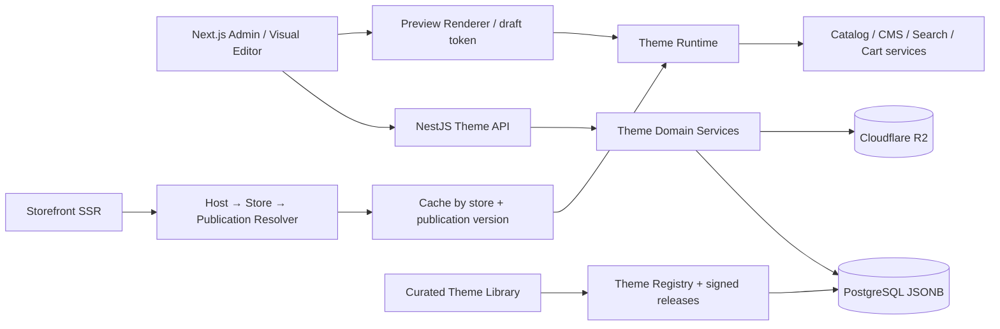

# Theme Engine STOREOS — arquitetura e plano de evolução

Status: proposta técnica para evoluir o editor atual sem substituí-lo.  
Branch de trabalho: `codex/theme-engine-architecture`.

## 1. Objetivo e princípios

O Theme Engine transforma o editor de vitrine existente em uma plataforma de temas instaláveis, configuráveis sem programação e segura para SaaS multi-tenant. Ele preserva o storefront atual e os dados de catálogo, pedidos e CMS.

Princípios:

1. **Compatibilidade primeiro:** o JSON atual de `Store.themeConfig`, `draftThemeConfig` e `StorefrontPublication` é o formato legado de publicação. A migração é aditiva; nenhuma publicação existente é apagada ou reescrita.
2. **Dados separados de apresentação:** produtos, categorias, coleções, menus, páginas, posts, checkout e políticas são fontes de dados/domínios da loja. Tema salva referências a esses recursos, nunca cópias dos cadastros.
3. **Renderização declarativa:** documento de layout JSON validado contra schemas versionados. Temas não enviam JavaScript, SQL, templates server-side nem HTML arbitrário para execução.
4. **Registro de componentes confiável:** componentes React são compilados e implantados pelo STOREOS. Pacotes de tema selecionam somente componentes e tokens permitidos em um catálogo por versão. CSS é escopado e tokens passam por validação.
5. **Isolamento de tenant:** toda instalação, rascunho, página, publicação, ativo e cache usa `storeId`; consultas privadas exigem identidade/escopo da loja.
6. **Publicação imutável:** editar nunca altera a vitrine pública. Publicar gera snapshot imutável e um número de versão; rollback publica um novo snapshot restaurado.
7. **Performance e disponibilidade:** SSR/ISR e CDN servem a última publicação. O editor usa preview privada e não força consulta dinâmica ao banco em cada visita pública.
8. **Extensibilidade controlada:** apps podem registrar extensões por contrato explícito e allowlist, sem injetar scripts arbitrários no tema.
9. **Acessibilidade e SEO como validação:** contraste, hierarquia de títulos, texto alternativo, navegação por teclado, metadados, canonical e dados estruturados fazem parte dos gates de publicação.
10. **Evolução por etapas:** primeiro temas nativos e páginas essenciais; catálogo público de terceiros vem somente após assinatura, revisão, compatibilidade e suporte de ciclo de vida.

## 2. Estado atual que será preservado

No `main`, o painel já tem:

- `StorefrontBuilder`: seções da página inicial ordenáveis, configuração de campos, presets visuais, identidade e cores;
- prévia responsiva em iframe usando a vitrine real e rascunho privado;
- salvamento automático com controle otimista de versão;
- publicação explícita, histórico recuperável e comparação de versões;
- modelo `StorefrontPublication` imutável e configuração ativa em `Store.themeConfig`;
- módulos separados para catálogo, categorias, coleções, menus, banners, páginas, mídia, domínio e SEO.

Limites atuais explícitos no editor: apenas um rascunho por loja, edição visual concentrada na home; produto, categoria, busca e páginas institucionais ainda usam composição padrão; seleções de produto/categoria são limitadas e não há biblioteca de temas com instalação/atualização. O Theme Engine deve eliminar esses limites sem quebrar os recursos já publicados.

## 3. Arquitetura lógica



### Limites de domínio

- **Theme Registry:** metadados, releases, compatibilidade e confiança de temas.
- **Theme Installation:** vínculo entre loja e release instalado.
- **Theme Editor:** criação/validação de drafts, previews e edição concorrente.
- **Theme Runtime:** interpreta documentos declarativos e resolve componentes allowlisted.
- **Publication:** valida, congela snapshot, incrementa versão e invalida/revalida cache.
- **Theme Marketplace:** catálogo, licença, aprovação e distribuição; separado do runtime da loja.
- **Storefront Data Adapters:** carregam dados públicos somente por contratos de catálogo, conteúdo, navegação, busca, carrinho e checkout já existentes.

## 4. Pacote de tema e contrato

Um tema publicado é um release imutável composto por:

- manifesto JSON: `id`, `slug`, `version`, `displayName`, `author`, `license`, `minStorefrontApiVersion`, `supportedFeatures`, `assetManifest`, `templates`, `sectionDefinitions`, `globalSettingsSchema`, `defaultConfig`;
- tokens: cores, tipografia, escalas de espaçamento, largura, raios e breakpoints;
- definições de templates por rota/tipo de página;
- schemas JSON dos campos globais, das seções e dos blocos;
- referências a componentes React já registrados no runtime;
- assets estáticos otimizados em R2/CDN, com hash e MIME validado.

Um componente é um identificador estável como `storeos.hero.v1`, nunca um módulo JavaScript recebido de um lojista. O pacote contém configurações e referências, não código executável.

### Componentes controlados pelo runtime

- Navegação: header, menu desktop/mobile, breadcrumb, footer e aviso institucional.
- Marketing/editorial: hero, banner/imagem responsiva, carrossel, texto, benefícios, depoimentos, FAQ, newsletter, vídeo por provedor allowlisted.
- Comércio: coleção/categoria, grade/carrossel de produtos, busca e resultados, filtros, card de produto, seletor de variação, disponibilidade, carrinho.
- Conteúdo: página institucional, blog/post, landing page e páginas vazias/404.
- Checkout: componente de sistema controlado pelo domínio Checkout. O tema pode definir tokens, logotipo e slots de apresentação aprovados; não pode alterar cálculo de preço, pagamento, antifraude, estoque, impostos ou submissão.

Cada definição de seção tem `type`, `schemaVersion`, `propsSchema`, limites, defaults, regras de acessibilidade/SEO e slots de blocos permitidos. O backend valida estrutura, tamanho, URLs, IDs de referência e limites antes de persistir e publicar.

## 5. Templates, páginas, seções e blocos

### Templates

Template = composição padrão de uma classe de rota. Tipos-base:

- `home`
- `product`
- `collection` / `category`
- `search`
- `cart`
- `page`
- `blog-index`, `blog-post`
- `landing`
- `not-found`

Templates do tema são defaults, não conteúdo da loja. O lojista pode substituir um template ou atribuir um template a uma página sem alterar os registros fonte.

### Documento de layout

JSON versionado por schema, no conceito de Online Store 2.0:

```json
{
  "schemaVersion": 1,
  "themeRelease": "storeos-editorial@1.0.0",
  "templates": {
    "home": { "sections": [
      { "id": "sec-hero", "type": "storeos.hero.v1", "enabled": true, "settings": {}, "blocks": [] },
      { "id": "sec-products", "type": "storeos.product-collection.v1", "enabled": true,
        "settings": { "source": { "kind": "collection", "id": "collection-id" }, "limit": 8 }, "blocks": [] }
    ] }
  },
  "global": { "designTokens": {}, "header": {}, "footer": {}, "navigation": {} }
}
```

O exemplo é ilustrativo do contrato; os IDs de catálogo são referências do tenant, validadas pelo servidor. O runtime aplica defaults do release e migrações declaradas quando o schema evolui.

### Seções e blocos reutilizáveis

- Seções são reutilizáveis em todos os templates habilitados pelo manifesto.
- Blocos são filhos ordenáveis de uma seção (ex.: grupo de imagem + texto + botão) sujeitos ao schema daquela seção.
- Instâncias têm UUID estável, ordem, estado ativo, settings, visibilidade/programação opcional e configuração por breakpoint.
- Reordenação usa operações semânticas e controle de concorrência; não se depende de posição como identidade.
- Seções dinâmicas referenciam produtos/categorias/coleções; filtros e ordenação usam enums permitidos, nunca expressões livres.

## 6. Modelo relacional (PostgreSQL/Prisma)

Manter `StorefrontPublication` e os campos atuais como compatibilidade e publicar, por migração aditiva, os seguintes conceitos. Toda entidade de tenant inclui `storeId` e índices compostos de acesso.

| Entidade | Campos principais | Propósito |
|---|---|---|
| `ThemePackage` | id, slug unique, ownerType, trustLevel, createdAt | Identidade imutável do tema/família. |
| `ThemeRelease` | id, themePackageId, version, manifest JSONB, manifestHash, assetPrefix, minRuntimeVersion, status, releasedAt | Release semântico, assinado e imutável. Unique(package, version). |
| `ThemeListing` | id, themePackageId, title, summary, screenshots JSONB, category, priceModel, visibility, moderationStatus | Entrada curada no marketplace; não contém lógica de runtime. |
| `ThemeInstallation` | id, storeId, themePackageId, themeReleaseId, status, installedAt, installedBy | Tema disponível/ativo na loja. Unique(storeId, themePackageId); índice storeId/status. |
| `ThemeDraft` | id, storeId, installationId, name, schemaVersion, basePublicationVersion, document JSONB, revision, createdBy, updatedAt | Draft editável e concorrente. Índice storeId/installationId/updatedAt. |
| `ThemePublication` | id, storeId, installationId, draftId, version, document JSONB, documentHash, publishedBy, publishedAt, scheduledAt, state | Snapshot imutável, publicação/rollback auditável. Unique(storeId, version). |
| `ThemePageAssignment` | id, storeId, routeType, resourceId nullable, templateKey, enabled | Atribui template à home, categoria, produto, página ou landing page. Unique(storeId, routeType, resourceId). |
| `ThemeEntitlement` | id, storeId, listingId, licenseStatus, validFrom, validUntil, orderId | Licença/assinatura futura de tema externo. Só necessário para marketplace comercial. |
| `ThemeEvent` ou Outbox | eventId, storeId, type, aggregateId, payload mínimo, occurredAt | Publicação, instalação, migração e invalidação de cache com retry idempotente. |

### Restrições e integridade

- FKs compostas sempre que possível para impedir referência cruzada entre lojas.
- Constraints únicas para evitar dois temas ativos ou publicação duplicada.
- Snapshots publicados não recebem UPDATE/DELETE; restauração cria nova publicação.
- `document` JSONB tem tamanho máximo e é validado contra release instalado.
- Índices: `(storeId, status)`, `(storeId, installationId, updatedAt)`, `(storeId, version)`; GIN somente em caminhos JSON realmente consultados.
- Assets ficam fora do banco, em R2, com hash, MIME, dimensões, tamanho, loja/tema e política de cache. Nunca armazenar blobs de tema executáveis.

### Migração do estado existente

1. Release nativo `storeos-classic@1.0.0` descreve exatamente os componentes e presets atuais.
2. Para cada loja, criar instalação e draft inicial lendo `draftThemeConfig` (se presente), sem alterar o original.
3. Mapear `themeConfig` e `StorefrontPublication` existentes para snapshots de compatibilidade.
4. Comparar a renderização antiga e nova em testes de golden/screenshot.
5. Só promover a leitura pelo novo resolver após equivalência validada; manter fallback legado e plano de rollback.
6. Mudanças futuras de banco seguem expand/dual-read/cutover; nunca exigir migração destrutiva para abrir loja já publicada.

## 7. Editor visual sem código

### UX

- Rota atual “Personalizar loja” evolui para um editor imersivo de três painéis: páginas/templates e árvore de seções à esquerda; canvas no centro; propriedades contextuais à direita.
- Toolbar: nome do tema e draft, desfazer/refazer, estado salvo, viewport desktop/tablet/mobile, preview privado, acessibilidade/SEO, salvar e publicar.
- Selecionar elemento no canvas foca sua seção/bloco na árvore; inserir, ocultar, duplicar, remover e reordenar via drag-and-drop e comandos acessíveis por teclado.
- Preview é o mesmo Theme Runtime da vitrine, em iframe isolado, com token assinado, curto e só de leitura do draft. Não é uma rota pública nem aceita ID de loja arbitrário.
- Inserção de conteúdo usa seletores tipados (produto, coleção, categoria, página, banner e menu); nunca pede slug/ID manual ao comerciante.
- Design global inclui presets e tokens com reset por token, tipografia legível, foco visível, validação de contraste e overrides responsivos limitados.
- Editor oferece autosave debounced, salvamento manual, estado offline/conflito, undo/redo no cliente e prevenção de perda de alterações.

### Persistência de edição

`PATCH /api/v1/stores/:storeId/theme/drafts/:draftId` recebe operações permitidas, `expectedRevision` e `idempotencyKey`. Backend valida escopo/RBAC e faz compare-and-swap da revisão. Conflito retorna `409` com revisão atual; cliente pode recarregar/mesclar, sem sobrescrita silenciosa.

## 8. Resolução e renderização

1. Resolver `Host` para domínio verificado e `Store`; para subdomínios, lookup tenant-safe.
2. Ler somente a publicação ativa e obter chave cache `storeId:publicationVersion:routeType:resourceId`.
3. Carregar manifest/release pelo hash da publicação; validar compatibilidade.
4. Resolver template, global settings e seções habilitadas.
5. Buscar dados publicáveis dos módulos (catálogo/CMS) em lote, com limites e caches.
6. Renderizar componentes compilados por SSR e servir assets otimizados por CDN.

Cache é invalidado por publicação, mudança relevante de conteúdo e alterações de catálogo ligadas à página. Nunca cachear por host não validado sem normalização, nem incluir dados pessoais. Erros de release novo não retiram o snapshot anterior; deploy tem fallback para última versão saudável.

### Performance

- Sem carregamento de código de tema por tenant. Um runtime compilado serve milhares de lojas.
- Evitar N+1 de produto por seção; resolver referências em lote e limitar quantidade.
- Imagens responsive com variantes srcset, dimensões explícitas, lazy loading abaixo da dobra e prioridade só para LCP.
- JS do editor fica fora do bundle público; widgets de terceiros não são síncronos.
- Cache CDN público por versão do snapshot e revalidação por tags.
- Métricas: TTFB, LCP/INP/CLS, cache hit, render errors, duração de publicação e preview.

## 9. Publicação, agendamento e rollback

### Gate

Antes de publicar: validar JSON/schema e release; integridade das referências tenant-local; seções obrigatórias; links/rotas; tamanho e origem de assets; contraste WCAG 2.2 AA; textos alternativos; hierarquia semântica; SEO base; componentes de checkout obrigatórios; e compatibilidade mínima do runtime. Erros impedem publicação; avisos podem ser aceitos explicitamente.

### Transação

1. Iniciar transação e checar revisão esperada do draft.
2. Persistir erros/avisos de validação de forma saneada.
3. Gerar hash canônico e criar snapshot imutável com número de versão seguinte.
4. Atualizar publicação ativa/ponteiro da instalação, registrar autor e auditoria.
5. Gravar evento no Outbox na mesma transação.
6. Revalidador/CDN processa evento com retry; enquanto não conclui, runtime mantém versão anterior.
7. Confirmar status e URL de preview/publicação à interface.

Agendamento cria `scheduledAt` e worker confiável publica a mesma operação transacional no horário; sem worker, não anunciar a funcionalidade. Rollback seleciona snapshot antigo como fonte, mas cria versão nova.

## 10. REST API (contrato alvo)

Usar autenticação atual de painel, RBAC e resolução de tenant; não usar segredo do lado cliente.

- `GET /api/v1/theme-library` — lista temas compatíveis, filtros e paginação.
- `GET /api/v1/theme-library/:slug/releases/:version` — metadados, features e preview.
- `POST /api/v1/stores/:storeId/themes/install` — instala release aprovado; idempotency key.
- `GET /api/v1/stores/:storeId/themes` — instalações e tema ativo.
- `POST /api/v1/stores/:storeId/themes/:installationId/drafts` — cria draft por duplicação de publicação ou defaults.
- `GET /api/v1/stores/:storeId/themes/:installationId/drafts/:draftId` — documento + schema/definições allowlisted.
- `PATCH /api/v1/stores/:storeId/themes/:installationId/drafts/:draftId` — operações validadas e CAS.
- `POST /api/v1/stores/:storeId/themes/:installationId/drafts/:draftId/validate` — erros/avisos por seção/campo.
- `POST /api/v1/stores/:storeId/themes/:installationId/drafts/:draftId/preview-token` — token curto limitado a loja/draft.
- `POST /api/v1/stores/:storeId/themes/:installationId/drafts/:draftId/publish` — publicação atômica.
- `GET /api/v1/stores/:storeId/themes/publications` — histórico paginado.
- `POST /api/v1/stores/:storeId/themes/publications/:publicationId/restore` — novo draft baseado no snapshot.
- `POST /api/v1/stores/:storeId/themes/:installationId/uninstall` — permitido somente se não ativo; nunca remove conteúdo nem histórico.

As rotas públicas da vitrine não aceitam parâmetros de draft. Store IDs nas rotas administrativas são confirmados contra o usuário autenticado mesmo que já haja store context.

## 11. Segurança, acessibilidade e marketplace

### Segurança

- Manifests validados por JSON Schema estrito, tamanho/complexidade limitados; rejeitar `$ref` remoto, URLs privadas, javascript/data URLs não permitidas e HTML arbitrário.
- CSP estrita; upload de imagem com validação de assinatura de arquivo, antivírus quando disponível, transformação em serviço isolado e URLs assinadas no painel.
- Nenhum script de parceiro é executado na origem principal. Apps usam integração aprovada com sandbox/origin separada e consentimento.
- Rate limits por lojista, usuário, IP e operação; CSRF e cookies httpOnly para painel; auditoria de install/edit/publish.
- Preview token com expiração curta, audience, storeId, draftId e nonce; revogável e sem permissão de mutação.
- releases assinados e hashes verificados; fallback em caso de vulnerabilidade ou release incompatível.
- Exportação/exclusão LGPD separa conteúdo da loja de dados de clientes e logs.

### Acessibilidade

- WCAG 2.2 AA como alvo de aceitação: teclado completo, foco visível, labels, semântica, contraste, reduced motion, zoom 200%, áreas de toque adequadas e alt text.
- As mesmas verificações rodam no editor e no gate de publicação, com reparo sugerido em linguagem simples.
- Automated checks não substituem teste manual e leitor de tela.

### Marketplace

Fase inicial: biblioteca **curada e mantida pelo STOREOS**, apenas de temas nativos compilados pelo runtime.  
Fase posterior: criadores externos submetem pacote declarativo com assets e schemas; pipeline valida malware, permissões, acessibilidade, performance, compatibilidade e licença; equipe aprova e assina release; lojista instala conforme entitlement; update só em draft, com diff, backup e rollback. Reviews, pagamentos, comissão, reembolso e suporte pertencem ao domínio marketplace e não devem contaminar runtime/catálogo.

Não permitir na primeira versão upload de tema arbitrário Liquid/JS/PHP/ZIP executável. Compatibilidade futura com padrões externos exige conversor/SDK e auditoria, não execução direta de um tema Shopify/WooCommerce.

## 12. Observabilidade e operação

- Eventos estruturados: `theme.install.started/completed/failed`, `theme.draft.saved/conflict`, `theme.validation.failed`, `theme.publication.created/activated`, `theme.render.failed`.
- CorrelationId, storeId pseudonimizado nos logs de plataforma, release/hash e routeType; sem dados de cliente.
- DLQ/reprocessamento para revalidação de CDN; idempotência em publicação.
- Alertas para aumento de render errors, drafts inválidos, publicação que não propaga e regressão de Core Web Vitals.
- Rollout canário por loja e feature flag; migrations backward-compatible; teste de restauração e snapshots.
- Capacidade por tenant protegida por limites de tamanho do documento, número de seções/assets e limites de preview.

## 13. Testes e critérios de aceite

1. Migração não altera conteúdo nem versão publicada existente; snapshots legados renderizam igual.
2. Uma loja não lê, edita, publica, pré-visualiza ou lista releases/drafts de outra loja.
3. CAS evita lost updates; chamadas repetidas com idempotency key não duplicam publicação.
4. Manifest inválido, componente não permitido, URL perigosa, cross-store reference e documento gigante são rejeitados.
5. Publicação falha sem alterar tema ativo; falha de CDN conserva página antiga.
6. Rollback cria nova publicação e não modifica histórico.
7. Renderer cobre cada page type, viewport e estados vazios/erro.
8. Acessibilidade automatizada + teclado/leitor de tela em fluxos críticos.
9. Playwright verifica install → edição → preview → publish → storefront → rollback em desktop/mobile.
10. Lighthouse/Core Web Vitals e teste de carga com milhares de tenants sintéticos, concorrência, cache frio/quente e failover.
11. Prisma integration testa isolamento, consistência transacional e migração incremental.
12. CI exige lint, typecheck, unit/integration, E2E smoke, build e verificação de manifesto/contratos antes do deploy.

## 14. Plano de implementação incremental

### Fase 0 — compatibilidade e desenho (esta entrega)
Publicar esta arquitetura, reconciliar documentação anterior e aprovar contrato JSON/ADR sem mudar runtime.

### Fase 1 — engine declarativo compatível
Registrar `storeos-classic` como tema nativo; extrair runtime/manifest/section registry; criar migração aditiva para instalação, drafts nomeados e snapshots associados; importador legado e testes de golden. Editor atual segue funcionando via adaptador.

### Fase 2 — biblioteca inicial e edição melhorada
Catálogo curado de 2–3 temas originais; instalar/duplicar sem alterar publicado; seleção de produtos/coleções em picker; páginas/templates home, produto, categoria, busca e institucionais; editor de três painéis e drag-and-drop acessível.

### Fase 3 — CMS avançado
Blog, landing pages, header/footer/menu globais, agendamento de publicação, histórico/diff de drafts, SEO por template/rota, mídia responsiva e validação de publicação.

### Fase 4 — marketplace controlado
Portal de submissão de parceiro, assinatura/verificação de pacote, revisão e licença; rollout/upgrade com diff e rollback. Ativar somente após política de operação, suporte e billing definidos.

A cada fase: migração aditiva, rollout por feature flag e publicação sob opt-in; não remover caminhos legados antes de métricas e equivalência em produção.

## 15. Decisões de produto que evitam retrabalho

- Temas são apresentação; dados de catálogo/CMS são propriedade da loja.
- Biblioteca inicial é criada pelo STOREOS, não importada automaticamente de outro SaaS.
- Storefront não executa código arbitrário do comerciante ou de terceiros.
- Checkout, cálculos e regras fiscais são componentes de sistema não substituíveis.
- Personalização por desktop/tablet/mobile usa tokens e propriedades declarativas, não CSS livre como recurso padrão.
- Um tema descontinuado continua renderizando releases publicados até migração voluntária ou correção de segurança urgente.
- Marketplace é módulo separado, posterior à biblioteca nativa, com política de suporte e compatibilidade versionada.
